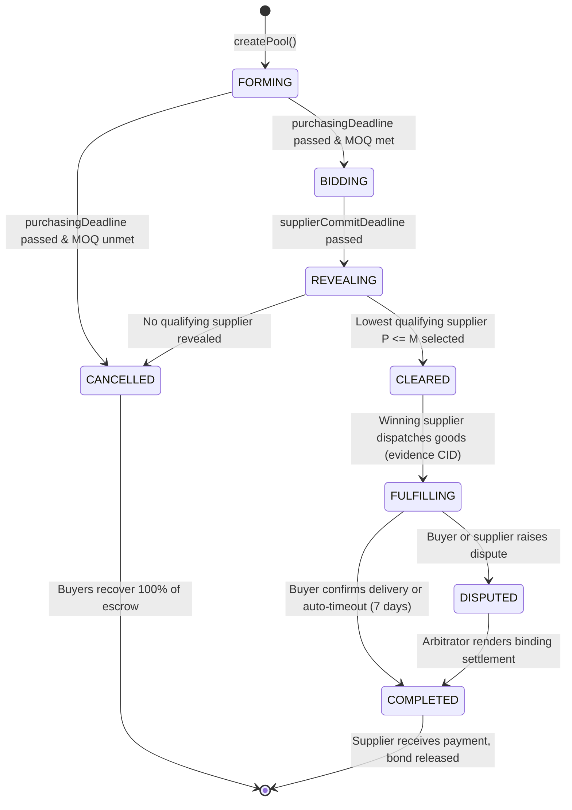

> Historical prototype document. This is not evidence of a deployed or audited mainnet product. See [current release status](../deployment/RELEASE_STATUS.md) and [v2 security review](../security/V2_REVIEW.md).

# HIVELOT System Architecture Specification
**The Autonomous Demand Clearing Network on QIE Mainnet (Chain ID 1990)**

---

## 1. System Topology Overview

HIVELOT is an autonomous multi-sided commerce protocol that inverts traditional e-commerce dynamics. Instead of sellers posting static prices and waiting for individual buyers, buyers aggregate purchase commitments into funded procurement pools. Verified suppliers compete in sealed-bid reverse auctions, and the on-chain ClearingHouse deterministically matches supply to establish a uniform clearing price.

```text
+-----------------------------------------------------------------------------------+
|                              BUYER INTERFACE & DAOs                               |
|   - Join Procurement Pool             - Escrow QUSDC Maximum (Di = qi * M)        |
|   - Withdraw Price Difference (Ri)    - Confirm Acceptance & Delivery             |
+------------------------------------------+----------------------------------------+
                                           |
                                           v
+-----------------------------------------------------------------------------------+
|                         HIVELOT CORE PROTOCOL (SOLIDITY)                          |
|                                                                                   |
|  [ProcurementFactory]  --->  Deploys & Lifecycle Enforces (FORMING -> CLEARED)    |
|  [DemandVault]         --->  Guarantees Token Solvency (Total Escrow = Li + Ri)   |
|  [SupplierAuction]     --->  Sealed Commit-Reveal with Performance Bonds          |
|  [ClearingHouse]       --->  Deterministic Lowest Qualifying Bid Settlement       |
|  [FulfillmentRegistry] --->  Dispatch Evidence Commitments & Auto-Acceptance      |
|  [DisputeResolver]     --->  EIP-712 Authorized Arbitration Resolution            |
|  [SupplierBondVault]   --->  Performance Collateral Protection                    |
|  [ProtocolTreasury]    --->  Settlement Fee Collection (0.75% BPS)                |
|  [MerchantRegistry]    --->  Verified Credentials, Tier Badges, Reputation        |
+------------------------------------------+----------------------------------------+
                                           ^
                                           |
+------------------------------------------+----------------------------------------+
|                              SUPPLIER TERMINAL                                    |
|   - Submit Sealed Bid Commitment (Hash) - Lock Performance Bond Collateral        |
|   - Reveal Unit Price & Capacity        - Dispatch Shipments with IPFS Evidence   |
+-----------------------------------------------------------------------------------+
```

---

## 2. Smart Contract State Machine

Procurement pools follow an immutable eight-phase state transition model:



---

## 3. Financial Invariant Guarantees

1. **Conservation of Escrow:**
   $$\sum_{i=1}^n D_i = \sum_{i=1}^n L_i + \sum_{i=1}^n R_i$$
   Where $D_i = q_i \times M$, $L_i = q_i \times P$, $R_i = q_i \times (M - P)$.
2. **Double-Claim Prevention:**
   Each buyer's price-adjustment refund $R_i$ has a boolean flag `refundWithdrawn` preventing duplicate withdrawals.
3. **Escrow Solvency:**
   Supplier payouts cannot occur until either explicit buyer acceptance or expiry of the 7-day challenge window following verified dispatch evidence.

